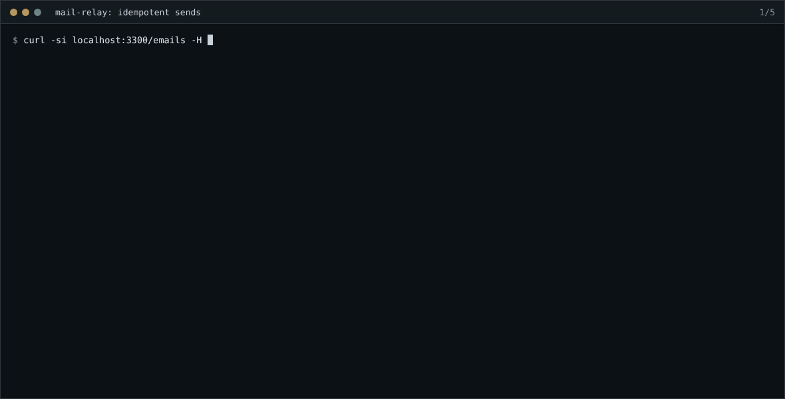

# mail-relay

Accepting an email over HTTP is the easy part. The hard part is everything after the `200`: a client that retries after a timeout and sends the invoice twice, a receiving server that greylists you, another that takes ten seconds per message and eats every connection you have, a worker that dies mid-send, and customers who need to know what happened without polling. mail-relay is a small email sending API built around those problems. It has a Postgres-backed delivery queue, SMTP workers in TypeScript and Go that share it, and signed webhooks.



## How it works

```
POST /emails ──► emails + one delivery row per recipient + email.sent event   (one transaction)
                       │
                       ▼
          claim_deliveries()  ◄── TypeScript worker (src/queue)   ◄─┐ same SQL contract,
          SKIP LOCKED + lease ◄── Go worker (go/internal/worker)   ◄─┘ can run side by side
                       │
             SMTP ─────┴──► 2xx delivered · 4xx retry with backoff · 5xx bounced · out of attempts → dead
                       │
          every transition records an event ──► webhook_messages ──► signed POST to customer endpoints
```

### Sending

- **Idempotency keys that hold under concurrency** ([`src/api/idempotency.ts`](src/api/idempotency.ts)). The key row is inserted first, in the same transaction that creates the email. A second request with the same key blocks on that insert until the first one commits, then replays the stored response with `idempotent-replayed: true`. If the first one rolled back, the second takes the key and does the work. A different body under the same key gets a `409`. The body is hashed canonically, so key order doesn't matter. Keys are scoped per team and expire after 24 hours. Expired keys are taken over in place and swept in batches. A test fires 25 concurrent requests with one key and expects exactly one email.
- **API keys hashed at rest.** Tokens are 32 random bytes and only their SHA-256 is stored. A slow KDF would only add latency to every request, since there is nothing to brute-force.
- **Per-key rate limiting** ([`src/api/rate-limit.ts`](src/api/rate-limit.ts)). This is a token bucket in a Redis Lua script, so it's atomic and uses Redis's clock rather than each API node's. Responses carry `ratelimit-limit` and `ratelimit-remaining`, and a `429` adds `retry-after`. If Redis is unreachable the API lets requests through (`FailOpenRateLimiter`). A Redis failover shouldn't stop customers from sending.
- **Batches are all or nothing.** `POST /emails/batch` takes up to 100 emails. Each one is validated, and every sender domain is checked against the team's verified domains before the first insert. A bad entry fails the whole batch and the error says which one (`7.to: Invalid email address`, `domain is not verified (email 3)`).

### The queue

The queue contract lives in Postgres functions ([`migrations/0002_queue_contract.sql`](migrations/0002_queue_contract.sql)). Both workers call `claim_deliveries`, `complete_delivery` and `fail_delivery`, so lease, retry and event rules can't drift between the TypeScript and Go implementations. The mixed benchmark below runs one of each on the same queue.

- **Leases, not locks held across network calls.** A claim marks the row `sending` and moves `available_at` to the lease expiry, then commits. The SMTP conversation happens outside any transaction. A row is claimable when it's queued and due, or sending with an expired lease (its worker died), so one partial index serves both cases.
- **Fencing.** Every claim issues a fresh `lease_token`, and every outcome must present it. A slow worker whose lease expired and was taken over can't record a result or emit a second `email.delivered`. The tests cover this in both languages.
- **Per-recipient-domain concurrency.** Before taking a row for a domain, the claimer takes a transaction-scoped advisory lock for that domain and counts live leases. The lock is try-only: a claimer never waits for another, and a busy or saturated domain is skipped for that round while the claimer moves on to other domains. That is what keeps a slow `gmail.com` from occupying every worker slot (numbers below). Limits are per domain in `recipient_domain_limits`, with a default.
- **Retries.** 4xx and connection failures are retried with exponential backoff and "equal jitter": between half and all of `min(cap, base * 2^(attempt-1))`. The delay is never zero, and retries spread out instead of arriving in waves. 5xx bounces immediately. After `max_attempts` the delivery goes to `dead`. When the reply carries an enhanced status code (`550 4.2.1 ...`), its class wins over the basic code ([`src/smtp/classify.ts`](src/smtp/classify.ts), [`go/internal/smtpx/classify.go`](go/internal/smtpx/classify.go)).
- **Graceful shutdown.** Workers only claim as many rows as they have free slots, so every lease they hold is a send in progress. On `SIGTERM` they stop claiming and wait for in-flight sends to finish and be recorded. The ECS task definition gives them 120 s for it. Anything still running after that keeps its lease until it expires, and another worker picks it up.
- **Connection reuse.** Real MTAs pause before the greeting, and the fake one waits 100 ms like `smtp-server` does by default. Opening a connection per message capped a worker at a few messages per second per slot. The TypeScript worker uses a pooled transport, and each Go sender goroutine owns one long-lived connection, sending `RSET` after a rejection. Both turn off Nagle's algorithm. Without that, the final `.` of `DATA` waited for a delayed ACK and every message cost an extra 40 ms ([`src/smtp/sender.ts`](src/smtp/sender.ts)).

### Events and webhooks

- **Events are recorded once.** Every state transition calls `record_event` with a dedupe key (`delivered:<id>`, `delayed:<id>:<attempt>`), and a repeated key is a no-op. The same function fans the event out to the team's subscribed endpoints, with a unique `(event, endpoint)` constraint.
- **Signed like Standard Webhooks / Svix** ([`src/webhooks/signing.ts`](src/webhooks/signing.ts)). Each request carries the headers `webhook-id`, `webhook-timestamp` and `webhook-signature: v1,<base64 HMAC-SHA256 of id.timestamp.body>`. A test checks `sign()` against the published test vector, so receivers can use any existing verifier. `verify()` enforces a 5-minute window in both directions and compares with `timingSafeEqual`. It accepts any one of several space-separated signatures, which is what happens during secret rotation.
- **At least once** ([`src/webhooks/dispatcher.ts`](src/webhooks/dispatcher.ts)). Messages are leased with `SKIP LOCKED` like deliveries, and the attempt counter doubles as the fencing token. Non-2xx responses and network errors are retried with the same backoff function. The `webhook-id` stays the same across retries, so receivers can drop duplicates.

### Operations

- **Queue metrics without a metrics client.** Workers log queue depth, in-flight count, the age of the oldest due delivery and recent dead letters. In AWS they log them as CloudWatch embedded metric format lines ([`src/queue/stats.ts`](src/queue/stats.ts)).
- **Terraform** ([`infra/`](infra)) builds a VPC with a NAT gateway per AZ, RDS Postgres 16 (Multi-AZ, managed password in Secrets Manager, `log_min_duration_statement`, `lock_timeout`, `idle_in_transaction_session_timeout`) and ElastiCache Redis. On ECS Fargate it runs the API behind an ALB, workers, the webhook dispatcher, an optional Go worker service and a one-off migration task. Workers autoscale on backlog per task (`QueueDepth / RunningTaskCount`). Alarms fire on queue age, dead letters, API 5xx, p95 latency and database CPU. The config passes `terraform fmt -check` and `terraform validate`.
- **Safe migrations.** The runner takes an advisory lock so two deploys can't migrate at once. Files marked `-- migrate: no-transaction` run statement by statement, which is how the dequeue indexes are built with `CREATE INDEX CONCURRENTLY` ([`migrations/0003_dequeue_indexes.sql`](migrations/0003_dequeue_indexes.sql)).

## Numbers

Measured on a 2 vCPU / 8 GB VM with Postgres 16, Redis, the fake MTA and the workers all on the same machine. CPU was saturated in the throughput runs, so these numbers are a floor rather than a ceiling. Each table comes from a script in [`bench/`](bench).

**Queue throughput**: 20,000 queued emails to 20 domains, delivered over SMTP to the fake MTA, with workers as separate processes running 32 sends in flight each. Every run had zero duplicates at the MTA.

| Workers | Emails/s |
| --- | --- |
| 1 TypeScript | 943 |
| 2 TypeScript | 951 |
| 1 Go | 1,583 |
| 2 Go | 1,759 |
| 1 TypeScript + 1 Go, same queue | 1,389 |

**A slow domain**: 1,000 emails to a domain whose MTA takes 1 s per message, queued ahead of 2,000 emails to ten healthy domains. Two workers.

| | Healthy domains finished after |
| --- | --- |
| No slow domain (baseline) | 4.1 s |
| Slow domain, capped at 5 connections | 4.0 s |
| Slow domain, no cap | 18.7 s |

Without the cap, all 64 slots were busy with the slow domain and everything else waited behind it.

**`POST /emails` latency**: two recipients per email, HTTP over loopback, measured from the client. The API runs as its own process with real Postgres and Redis; each run is 5,000 requests.

| Concurrency | Idempotency-Key | Requests/s | p50 | p95 | p99 |
| --- | --- | --- | --- | --- | --- |
| 8 | no | 468 | 14.3 ms | 35.6 ms | 69.4 ms |
| 8 | yes | 483 | 14.7 ms | 30.8 ms | 41.9 ms |
| 32 | no | 777 | 39.4 ms | 65.2 ms | 77.1 ms |
| 32 | yes | 636 | 48.5 ms | 76.9 ms | 96.7 ms |

Numbers move by about 30% between runs on this machine. The cost of the idempotency key is one extra insert and update in the same transaction.

**The dequeue query** on a table with 1,000,000 finished deliveries and 1,000 due ones (`bench/explain.ts`):

```
--- without deliveries_dequeue_idx ---
Seq Scan on deliveries d (actual time=100.579..100.755 rows=1000 loops=1)
  Rows Removed by Filter: 1000000
Execution Time: 101.073 ms
claim_deliveries(limit 32), median of 20: 3841.6 ms

--- with deliveries_dequeue_idx (partial) ---
Index Scan using deliveries_dequeue_idx on deliveries d (actual time=0.010..0.010 rows=1 loops=1)
  Index Cond: (available_at <= now())
Execution Time: 0.034 ms
claim_deliveries(limit 32), median of 20: 4.5 ms

index size: partial 32 kB, full (status, available_at) 11 MB
```

The claim function runs the dequeue query once per row it takes, so a 100 ms sequential scan became a 3.8 s claim. The index is partial (`WHERE status IN ('queued', 'sending')`). Finished rows are the vast majority of the table, and the queue never reads them, so they stay out of the index. It stays at 32 kB however much history piles up. A plain `(status, available_at)` index is 11 MB and keeps growing.

## Tech stack

Node.js 22, TypeScript (strict, `noUncheckedIndexedAccess`), Fastify, zod, PostgreSQL 16 (`pg`), Redis (`ioredis`), nodemailer and smtp-server, Go 1.24 with pgx, Terraform on AWS (ECS Fargate, RDS, ElastiCache, ALB, CloudWatch), vitest and `go test`.

## Running it

Postgres 16 and Redis are needed. `docker compose up -d` starts both with the credentials the defaults expect.

```bash
npm ci
npm run migrate
WEBHOOK_URL=http://127.0.0.1:4300/hooks npm run seed     # prints an API key and the webhook secret

npm run mta                                                # fake MTA on :2525
RETRY_BASE_MS=3000 npm run worker                          # or: cd go && go run ./cmd/relay-worker
npm run webhooks
WEBHOOK_SECRET=whsec_... node scripts/webhook-receiver.ts 4300
PORT=3300 npm run api

curl -s localhost:3300/emails -H "Authorization: Bearer $KEY" -H "Idempotency-Key: order-1001" \
  -H "content-type: application/json" \
  -d '{"from":"Acme <hello@acme.test>","to":["ana@example.test","flaky@x.test","bounce@x.test"],"subject":"Hi","text":"Hello"}'
```

The fake MTA picks its behaviour from the recipient's local part. `bounce…@` gets a `550`, `tempfail…@` always gets a `451`, and `flaky…@` gets a `451` once and is then accepted. Slow domains are set with `SLOW_DOMAINS=slow.test=2000`.

| Endpoint | |
| --- | --- |
| `POST /emails` | `{from, to, subject, html?, text?, tags?}` returns `{id}`. Honours `Idempotency-Key` |
| `POST /emails/batch` | Up to 100 of the above, all or nothing. Returns `{data: [{id}]}` |
| `GET /emails/:id` | Per-recipient status and attempts, plus the event timeline |

Configuration is read from the environment in [`src/config.ts`](src/config.ts): `DATABASE_URL`, `REDIS_URL`, `SMTP_HOST`/`SMTP_PORT`, `WORKER_CONCURRENCY`, `DOMAIN_CONCURRENCY`, `LEASE_SECONDS`, `RETRY_BASE_MS` and `RETRY_CAP_MS`. The Go worker reads the same names.

## Tests

```bash
npm run typecheck
npm test            # 90 tests against real Postgres and Redis
npm run test:go     # 11 tests; Postgres tests run in a throwaway schema
```

The tests use `mailrelay_test` unless `MAILRELAY_TEST_DATABASE_URL` / `MAILRELAY_TEST_REDIS_URL` say otherwise. Nothing is mocked below the HTTP client. SMTP goes over real sockets to the fake MTA, and webhooks go to a real HTTP receiver. The suites cover:

- idempotency, including 25 concurrent requests with one key, a mismatched body, expiry and per-team scope
- `N` workers on one queue delivering each message exactly once
- lease expiry, recovery and fencing in both languages
- backoff bounds, dead letters and SMTP classification
- the per-domain concurrency cap, and shutdown with sends in flight
- webhook signing against the published test vector, timestamp tolerance and key rotation
- webhook retries with a stable `webhook-id`
- rate limiting under concurrent requests, and batch validation

## Layout

```
migrations/          schema, the queue contract as SQL functions, concurrently-built indexes
src/api/             Fastify app, idempotency, rate limiting, request schemas
src/emails/          address parsing, queueing, the email + timeline read model
src/queue/           claim loop, delivery worker, queue stats
src/smtp/            SMTP reply classification and the pooled sender
src/webhooks/        signing/verification and the dispatcher
src/mta/             fake MTA with injectable failures
src/cli.ts           migrate | seed | api | worker | webhooks | mta
go/                  Go delivery worker: smtpx, queue, worker, message rendering
infra/               Terraform for AWS
bench/               throughput, slow-domain, API latency and EXPLAIN scripts
test/                vitest suites and helpers
```

## Limitations

- Every recipient domain goes to one configured relay. There is no MX lookup, DKIM signing or outbound TLS policy.
- Delivery to the MTA is at least once. If a worker dies after the MTA accepted a message but before the outcome was recorded, the message is sent again. The `Message-ID` is stable across attempts so receivers can deduplicate.
- Domain verification is a flag on the `domains` table, with no DNS checks.
- Only successful responses are stored for idempotency keys. A request that failed validation can be retried with the same key.
- The webhook dispatcher doesn't isolate endpoints from each other, and it never disables an endpoint that keeps failing. A slow endpoint holds dispatcher slots until the 10 s timeout.
- The Terraform validates but hasn't been applied. With `sslmode=require`, node-postgres also needs the RDS CA bundle configured.

## License

MIT
